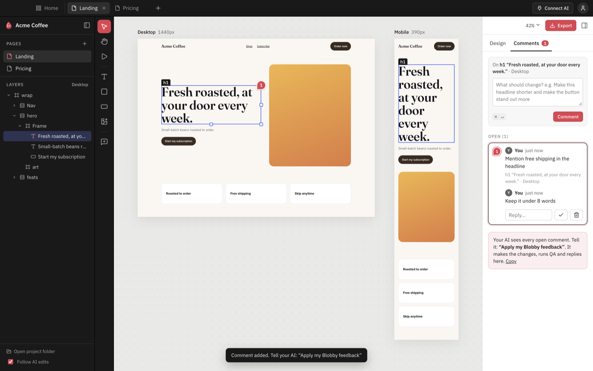
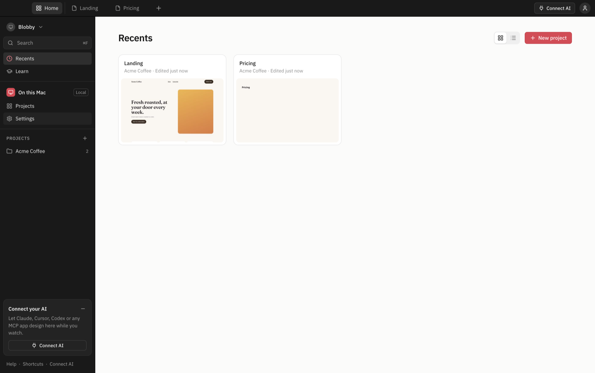
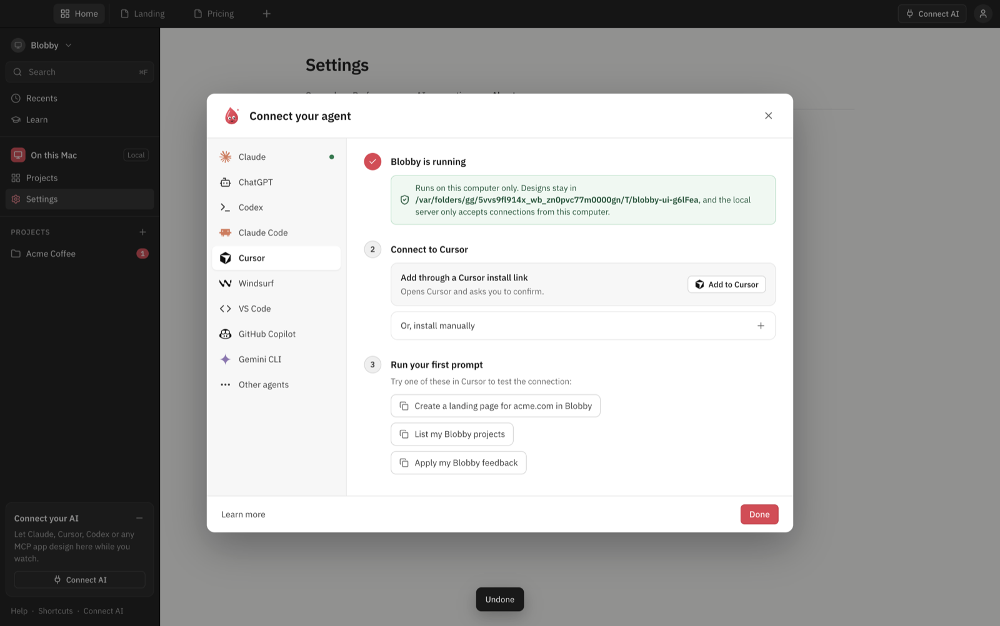

<p align="center"></p>

<h1 align="center">Blobby</h1>

<p align="center"><b>The design canvas your AI drives.</b><br>
Ask Claude, Cursor, Codex or any MCP app for a design and watch it appear: real HTML + CSS on desktop, tablet and mobile artboards. Click anything, leave a comment, and your AI fixes it. Export clean code when you're done.</p>

<p align="center">
  <a href="LICENSE"></a>
  
  
  
  
</p>

<p align="center"></p>

## Contents

[Why Blobby](#why-blobby) · [Quick start](#quick-start) · [Connect your AI](#connect-your-ai) · [Features](#features) · [Tech stack](#tech-stack) · [How it works](#how-it-works) · [MCP tools](#mcp-tools) · [Develop](#develop) · [Troubleshooting](#troubleshooting) · [Roadmap](#roadmap) · [FAQ](#faq)

## Why Blobby

- **Your AI, not ours.** Blobby has no built-in model, no account and no API key. It's an MCP server plus a canvas, so it works with the AI you already use.
- **Real code, not pictures.** Every design is a plain HTML page with CSS. What you see is what you export.
- **Feedback loop built in.** Select an element, press <kbd>C</kbd>, type what should change. Tell your AI "Apply my Blobby feedback" and it makes the change, checks it, and replies in the thread.
- **Not random.** The AI follows a set workflow: study the real site, write a brief, build section by section, then run automated QA on every artboard until it passes.
- **Local and private.** Projects are plain folders in `~/Blobby`. Nothing leaves your computer.

## Quick start

**Requirements:** [Node.js](https://nodejs.org) 20+, Git, and macOS. Windows and Linux should work but are untested.

```bash
git clone https://github.com/Ravindrabisht12/blobby.git
cd blobby
npm install      # also downloads Electron (~100 MB)
npm start
```

Then:

1. Click **Connect AI** and pick your app (Claude, Cursor, Codex, VS Code…). Follow the three steps.
2. Restart your AI app if it was open.
3. Ask it:

   > Create a landing page for acme.com in Blobby

Watch it build on the canvas. If you don't name a project, Blobby asks your AI which one to use, or creates one.

## Connect your AI

| App | How |
|---|---|
| Claude Desktop | **Connect AI → Claude → Add to Claude**: writes the config and keeps a backup |
| Claude Code | **Connect AI → Claude Code → Add to Claude Code**: runs `claude mcp add` for you |
| Cursor | One-click install link, or copy the JSON for `~/.cursor/mcp.json` |
| VS Code / GitHub Copilot | One-click install link (agent mode), or `.vscode/mcp.json` |
| Codex | Copy the `~/.codex/config.toml` snippet |
| Windsurf, Gemini CLI | Copy the JSON |
| Anything else | The local Streamable HTTP URL (while Blobby is open) or the stdio command |

<details><summary>Manual setup (stdio)</summary>

```json
{
  "mcpServers": {
    "blobby": {
      "command": "/path/to/blobby/node_modules/electron/dist/Electron.app/Contents/MacOS/Electron",
      "args": ["/path/to/blobby/src/mcp/server.js"],
      "env": { "ELECTRON_RUN_AS_NODE": "1" }
    }
  }
}
```

The exact command for your machine is in **Connect AI → Other agents**. The MCP server starts the app if it isn't running.
</details>

ChatGPT only connects to servers on the internet, so it can't reach a local app directly. Codex works locally today.

### Prompts to try

- `Create a landing page for stripe.com in Blobby, matching their brand`
- `Make a pricing page in my Acme project with three plans`
- `Apply my Blobby feedback`
- `Export the landing page from Blobby`

## Features

<p align="center"> </p>

| | |
|---|---|
| **Canvas** | Desktop (1440), tablet (768) and mobile (390) artboards side by side, updating live as your AI edits. Pan, zoom, and Interact mode (<kbd>P</kbd>) to try links and hovers |
| **Tools** | Select, hand, add text / box / button / image, comment |
| **Layers** | The page tree with layout direction (row, column, grid). Drag to reorder or nest |
| **Design panel** | Layout (flex/grid, alignment, gap), size, spacing, typography, fill, border, effects, position, plus brand tokens shared across the project |
| **Direct editing** | Drag to reorder, resize handles, double-click to edit text, copy / paste / duplicate, undo |
| **Comments** | Threads pinned to elements, with a screenshot of what you pointed at. Your AI reads them, fixes, and replies |
| **QA** | Horizontal overflow, color contrast (WCAG), tiny text, tap targets, broken images, missing alt text, placeholder copy, heading structure, JS errors, off-brand colors |
| **Workspace** | Tabs for open pages, Home with recents and projects (grid or list), search, hideable panels (<kbd>⌘\\</kbd>), native menu bar |
| **Export** | A clean `index.html` + `styles.css` + assets for any page (<kbd>⌘E</kbd>) |

Press <kbd>⌘/</kbd> in the app for all keyboard shortcuts.

## Tech stack

| Layer | Technology |
|---|---|
| Desktop shell | [Electron](https://www.electronjs.org) 45: main process, preload bridge, custom `blobby://` protocol |
| AI connection | [Model Context Protocol](https://modelcontextprotocol.io) via [`@modelcontextprotocol/sdk`](https://github.com/modelcontextprotocol/typescript-sdk): stdio and Streamable HTTP transports, elicitation for the project picker |
| Validation | [Zod](https://zod.dev) 4 schemas for every MCP tool input |
| HTML editing | [linkedom](https://github.com/WebReflection/linkedom): server-side DOM for precise element edits by id |
| Rendering and QA | Hidden Electron windows for screenshots, thumbnails, site analysis and in-page QA probes |
| UI | Plain JavaScript (ES modules), HTML and CSS: no framework, no bundler, no build step |
| Icons | [Lucide](https://lucide.dev) (UI) and [Simple Icons](https://simpleicons.org) (AI app logos), inlined as SVG |
| Storage | Plain files: HTML pages, JSON metadata, PNG/JPG assets in `~/Blobby` |
| Tests | Node scripts plus [Playwright](https://playwright.dev) driving the real Electron app |
| Runtime | Node.js 20+, ES modules throughout |

Three runtime dependencies in total: the MCP SDK, linkedom and Zod.

## How it works

```
 Your AI app (Claude, Cursor, Codex…)
        │  MCP (stdio or HTTP)
        ▼
 Blobby MCP server ──── writes ────▶ ~/Blobby/<project>/pages/*.html
        │                                      │
        │  local bridge (screenshots,          │  file watcher
        │  QA, current selection)              ▼
        └──────────────────────────▶ Blobby app: canvas reloads live
```

1. Your AI calls tools like `create_page`, `write_html` and `update_styles`. Every element gets a stable `data-b-id`, so edits are precise.
2. The app watches the folder and reloads the artboards, so you see each change as it happens.
3. For `get_screenshot` and `qa_check`, the MCP server asks the running app to render the page in hidden windows at each device width and run checks inside the page.
4. Your comments are saved next to the page, so `get_feedback` gives the AI the element, your words and a screenshot.

| Path | What |
|---|---|
| `src/mcp/tools.js` | MCP tools, the design workflow instructions, and prompts |
| `src/mcp/server.js` | stdio entry point. Talks to the running app over a local bridge and starts it if needed |
| `src/shared/store.js` | Projects, pages, element ids, edits, moves, undo, comments, briefs, export |
| `src/shared/probes.js` | In-page scripts for brand extraction and QA checks |
| `src/shared/render-tasks.js` | Screenshots, QA, site analysis and thumbnails |
| `src/main/` | Electron: `blobby://` protocol, file watcher, bridge, local HTTP MCP, native menu |
| `src/renderer/` | The UI |

A project on disk:

```
~/Blobby/acme/
  project.json        name, site, brand tokens
  pages/landing.html  the design
  assets/             images
  feedback.json       comments and replies
  briefs/             what each page is for
  .history/           undo snapshots
```

## MCP tools

28 tools and 2 prompts. The server also sends your AI a step-by-step design workflow, so results are consistent.

| Group | Tools |
|---|---|
| Projects | `list_projects`, `create_project`, `get_project`, `set_brand` |
| Research and planning | `analyze_site`, `create_page`, `get_brief`, `set_brief` |
| Reading | `get_tree`, `get_html`, `get_selection`, `get_screenshot` |
| Editing | `write_html`, `set_css`, `update_styles`, `set_text`, `set_attributes`, `move_nodes`, `delete_nodes`, `duplicate_page`, `add_asset`, `undo` |
| Quality | `qa_check` |
| Feedback | `get_feedback`, `reply_feedback`, `resolve_feedback` |
| Output | `export_page`, `open_in_blobby` |
| Prompts | `design_page`, `apply_feedback` |

## Develop

```bash
npm start            # run the app
npm test             # MCP smoke test over stdio (temp folder)
npm run test:ui      # drives the real app with Playwright (temp folder; never touches ~/Blobby)
```

| Variable | Default | What |
|---|---|---|
| `BLOBBY_HOME` | `~/Blobby` | Projects folder |
| `BLOBBY_MCP_PORT` | `7788` | Port for the local HTTP MCP endpoint |

There's no build step: edit a file in `src/renderer/` and reload the window (<kbd>⌘R</kbd>). Changes in `src/main/` need a restart. See [CONTRIBUTING.md](CONTRIBUTING.md).

## Troubleshooting

<details><summary><b>npm install fails while downloading Electron</b></summary>

Run `npm install` again (it's often a network hiccup). Behind a proxy, set `ELECTRON_MIRROR`. Make sure you're on Node 20 or newer: `node -v`.
</details>

<details><summary><b>My AI app doesn't show Blobby's tools</b></summary>

Restart the AI app after connecting. Most apps only read MCP settings at startup. In **Connect AI**, a green dot next to Claude or Claude Code means the config was written.
</details>

<details><summary><b>"Port 7788 in use"</b></summary>

Another program is using the port. Start Blobby with `BLOBBY_MCP_PORT=7790 npm start`, then copy the new URL from **Connect AI**.
</details>

<details><summary><b>The AI says Blobby isn't running</b></summary>

With stdio setups the MCP server starts the app for you. With the HTTP URL, keep Blobby open while you work.
</details>

## Roadmap

- [ ] Breakpoint-specific edits in the design panel
- [ ] Redo
- [ ] Component library and reusable sections
- [ ] Figma and React exports
- [ ] Packaged installers

Ideas welcome: [open an issue](https://github.com/Ravindrabisht12/blobby/issues).

## FAQ

**Does Blobby cost anything or need an API key?** No. It uses the AI app you already have.

**Which AI works best?** Any model that's good at front-end code. Claude and Codex give strong results with the built-in QA loop.

**Can I edit the files directly?** Yes. They're plain HTML and JSON in `~/Blobby`, and the canvas updates when they change.

**Can I use the export in production?** Yes. It's standard HTML and CSS with no runtime, so you can drop it into any site or framework.

## Contributing

Issues and pull requests are welcome. See [CONTRIBUTING.md](CONTRIBUTING.md). This is a side project, so replies may take a while.

## License

[MIT](LICENSE) © Ravindra Bisht. Icons from [Lucide](https://lucide.dev) (ISC). App logos in Connect AI from [Simple Icons](https://simpleicons.org) (CC0); those marks belong to their owners and are shown only to indicate compatibility.
